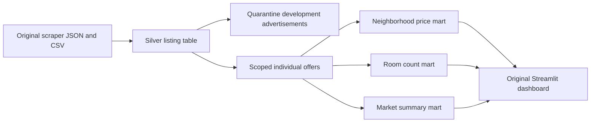

# Real estate pipeline execution and validation

This repository contains a small Windows execution adapter and validation notes for [Bahna-Darius's real-estate-data-pipeline](https://github.com/Bahna-Darius/real-estate-data-pipeline). It is not a newly authored real estate pipeline. The original scraper, Silver transformation, Gold aggregations, dashboard and eight test assertions belong to the upstream author.

Pinned source commit: `a7ab704445b3da4218b4fd9371c1359430cda433`.

## Verified local run on 14 October 2026

- Live source: two pages of public Bucharest apartment sale listings on storia.ro, fetched using the upstream scraper.
- 70 raw records processed by the original PySpark Silver transformation.
- Three development advertisements quarantined; 67 individual apartment offers retained.
- Original Gold functions produced six neighborhood groups, five room groups and one market summary.
- SQL count and average-price reconciliation passed; IDs were unique, and missing/nonpositive prices, invalid areas and price/area inconsistencies were all zero in this snapshot.
- Average asking price of the 67 retained offers: EUR 157,515; unweighted average of individual asking prices per m²: EUR 2,078. These are sample descriptive statistics, not representative market valuations or completed transaction prices.
- All eight upstream test assertions passed with an equivalent SQL fixture adapter. Running the unmodified original suite on this Windows runtime gave seven Python-worker crashes and one pass. Do not describe the unmodified suite as passing.
- Original Streamlit dashboard ran successfully; changing the price metric and selecting no sectors produced no application exception.

Machine-readable evidence is in `results/run_report.json`. Aggregate CSVs and quarantined records are under `results/`. The run was executed with AI assistance; the applicant should walk through the code and results before representing these skills in an interview.

## What changed for Windows

The adapter imports and executes the original `transform_bronze_to_silver`, `build_by_neighborhood`, `build_rooms_distribution`, and `build_market_summary` functions. It does not replace their transformations with pandas equivalents.

1. Read the exact raw JSON file. Reading its containing directory would also ingest a CSV file, which is an input-format risk.
2. Write the small collected results to CSV/Parquet with pandas/pyarrow, avoiding Windows Hadoop native writer requirements. This small-data workaround is not a scalable distributed export strategy.
3. Apply an explicit business-scope rule before Gold aggregation: retain `/ro/oferta/` individual offers; exclude `/ro/ansamblu/` development advertisements.
4. Execute the upstream tests' original assertions against their exact five fixture records constructed with Spark SQL `VALUES`; this avoids the Python-worker input-serialization failure without modifying the transformation or expected values.

## Why the business rule matters

Two excluded development advertisements advertised `de la 1800 €/m²` and `de la 1650 €/m²`. The original numeric parser treated these as total EUR prices. A third development advertisement quoted EUR 332,750 but was also outside the individual-offer grain. Mixing these records gave an implausible EUR 1,650 minimum price and EUR 155,567 average. Excluding the three records changed the minimum to EUR 66,500 and the average to EUR 157,515.

This is a semantic data-quality issue: successful numeric conversion alone does not ensure comparable measurements. Records are quarantined rather than silently relabeled or multiplied by an uncertain representative area.

## Run on Windows

Requirements: Python 3.12, Git, a JDK 17 installation. Use a virtual environment. Java was downloaded from the official Azul distribution into the task workspace; no system-wide Java configuration was changed.

```powershell
python -m venv .venv
.\.venv\Scripts\python.exe -m pip install -r requirements.txt
git clone https://github.com/Bahna-Darius/real-estate-data-pipeline.git upstream
git -C upstream checkout a7ab704445b3da4218b4fd9371c1359430cda433
# Set JAVA_HOME to your actual JDK 17 folder first.
$env:PATH = "$env:JAVA_HOME\bin;$env:PATH"
$env:PYSPARK_PYTHON = (Resolve-Path '.\.venv\Scripts\python.exe').Path
$env:SPARK_LOCAL_IP = '127.0.0.1'
.\.venv\Scripts\python.exe run_reproduction.py --upstream upstream --scrape-pages 2
$env:UPSTREAM_DIR = (Resolve-Path upstream).Path
.\.venv\Scripts\python.exe -m pytest test_upstream_windows.py -v
.\.venv\Scripts\python.exe -m streamlit run upstream/dashboards/app.py --server.address 127.0.0.1 --server.headless true --browser.gatherUsageStats false
```

Run these commands from the reproduction directory. The separate upstream checkout is pinned so later commits to this fork do not change the code being validated.

Live listings change. Another scrape can produce different counts, prices and groups. The recorded results refer only to the input SHA-256 in `run_report.json`; they must not be promised for future scrapes.

## Data model



- Silver grain: one advertisement, keyed by the upstream MD5 of its URL. Raw strings become typed EUR prices, square metres, rooms and cleaned location fields.
- Gold neighborhood grain: sector plus neighborhood; only groups with at least two listings are retained. This means neighborhood charts do not cover every one of the 67 offers.
- Gold room grain: room count; records with missing rooms are excluded by upstream code.
- Gold summary grain: one row for the scoped sample.
- This is a wide listing table plus aggregate marts, not a dimensional star schema or SCD implementation.
- Average EUR/m² is the arithmetic mean of listing-level ratios, not total prices divided by total area. Aggregation averages skip null values; valid coverage should be checked when new inputs arrive.

## Scope and provenance

Microsoft Fabric, OneLake, Azure, Databricks, Airflow, Docker and Power BI were not executed in this reproduction. The upstream contains references to several of them, but that does not constitute hands-on deployment experience here.

This repository is the applicant's fork of the upstream project. The reproduction folder records the locally executed Windows adaptation and validation; upstream authorship is retained.

The pinned upstream checkout has no repository license file. This package therefore does not redistribute its source; the commands fetch it from the original author. Attribution is preserved. Scraped listing descriptions and raw input are not included in this package.
